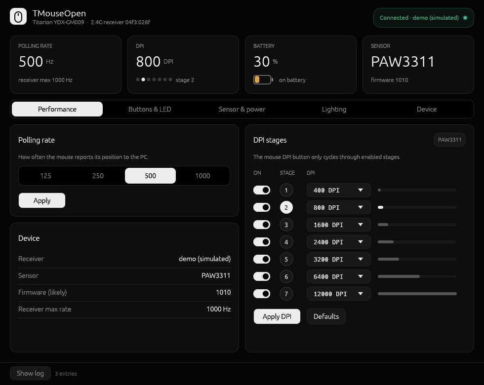
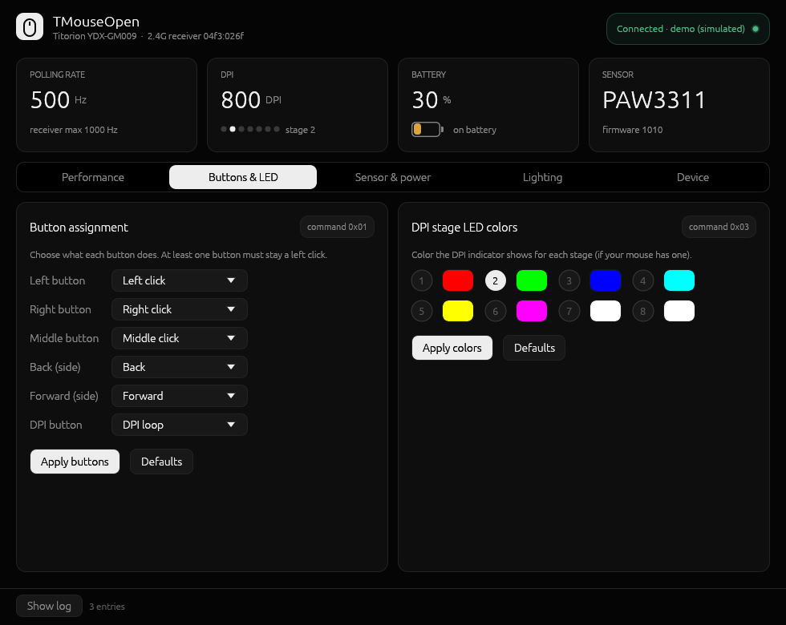
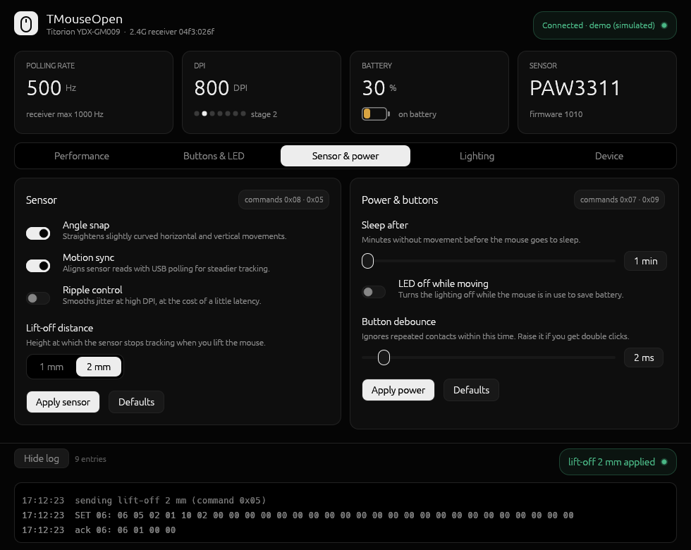
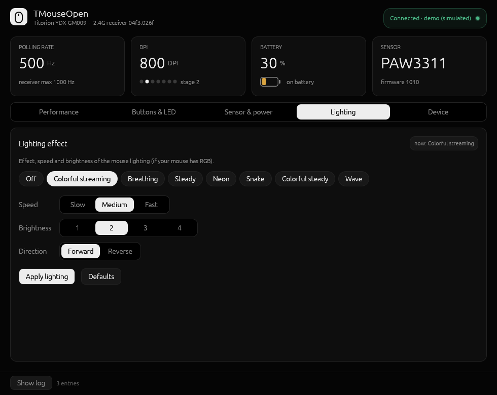
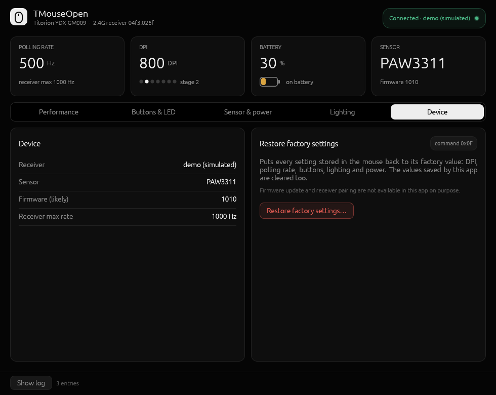
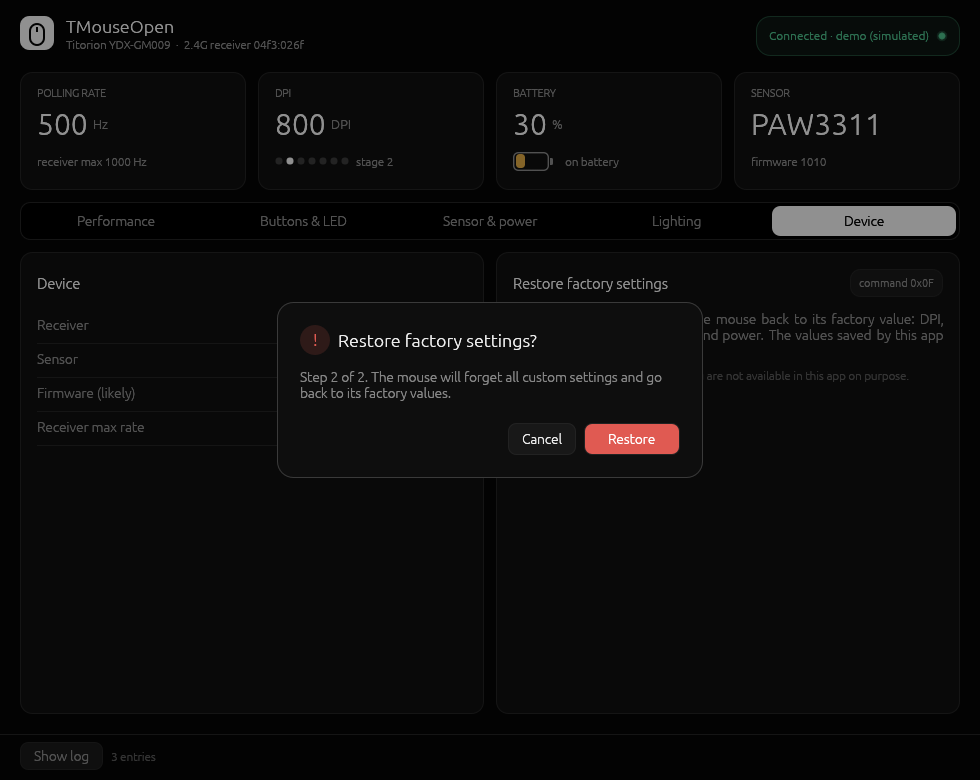
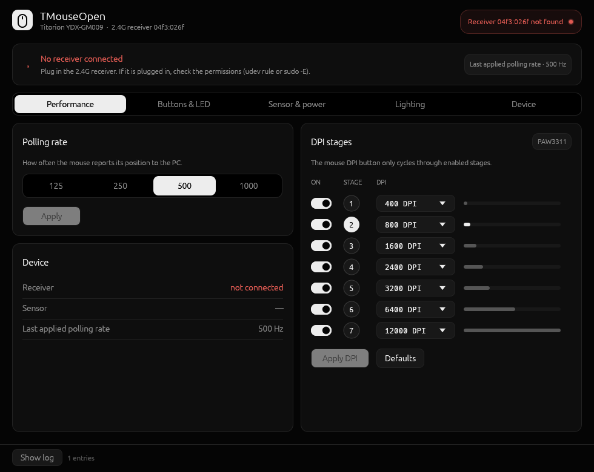

# TMouseOpen

Linux configurator for the **Titorion YDX-GM009** mouse (2.4G receiver `04f3:026f`, PAW3311 sensor).
Shows polling rate, active DPI stage, battery, charge state, sensor and lighting effect, and changes
polling rate, DPI stages, button assignment, DPI LED colors, sensor options (angle snap, motion sync,
ripple control, lift-off), sleep timer, button debounce and lighting, and can restore the factory settings.



| Buttons & LED | Sensor & power (applied, log open) | Lighting |
|---|---|---|
|  |  |  |

| Device and factory reset | Factory reset confirmation | No receiver connected |
|---|---|---|
|  |  |  |

*Screenshots taken with `--demo` (simulated mouse) on Xvfb; no hardware was touched.*

## Interface
- **Stat tiles** at the top: polling rate (with the receiver's maximum), active DPI and stage, battery level and charge state, sensor and firmware.
- **Performance**: polling rate (segmented control: 125 / 250 / 500 / 1000 Hz) and the 7 DPI stages (on/off switch, click a number to make it active, DPI picker, bar relative to 12000 DPI).
- **Buttons & LED**: function of each of the 6 buttons (left, right, middle, back, forward, DPI loop) and the LED color of each DPI stage.
- **Sensor & power**: angle snap, motion sync, ripple control, lift-off distance (1/2 mm), sleep timer (1–8 min), LED off while moving and button debounce (0–30 ms).
- **Lighting**: effect (off, colorful streaming, breathing, steady, neon, snake, colorful steady, wave), speed, brightness and direction; the tile shows the effect the mouse reports.
- **Device**: receiver details and **Restore factory settings** (two confirmations).
- **Status bar**: connection pill, result of the last command and a collapsible log with every frame sent and acknowledged.

## Where the commands come from
The commands beyond polling and DPI were recovered by static reverse engineering of the official
Windows software (GamingMS v2.1.5, analyzed with [REA](https://github.com/morluto/rea) + Ghidra, never executed)
and then confirmed on the mouse. See `PROTOCOL.md` for each command's bytes and origin.
- **Only the official ranges**: values are limited to what the official software itself offers (debounce 0–30 ms, sleep 1–8 min, 3 speed and 4 brightness levels…); anything else is rejected before a frame is built, and unit tests check every frame byte by byte.
- **Only known button functions**: the 6 functions whose codes are confirmed by the official profiles and the firmware's own default table. At least one button must stay a left click.
- **Batches stop at the first failure**: if the mouse does not acknowledge a command, the rest of that batch is not sent.
- **No firmware, pairing or macros**: reports 0xBC/0xBF do not exist in the code, the device layer refuses any command code outside the allowed list, and macro upload (0x10/0x11) is not implemented.
- **Way back**: Device → Restore factory settings (two confirmations) sends the official "Restore" command.

## Prebuilt binary (Debian 11, 12, 13)
Download `tmouseopen-<version>-linux-x86_64.tar.gz`, then:
```bash
tar xzf tmouseopen-*-linux-x86_64.tar.gz
cd tmouseopen-*-linux-x86_64
./tmouseopen --demo      # try the UI without the mouse
```
The binary needs glibc 2.30 or newer (Debian 11 ships 2.31) and no extra packages beyond a normal desktop.
See **Permissions** below to access the receiver.

## Build (Debian/Ubuntu)

```bash
sudo apt install build-essential curl
curl --proto '=https' --tlsv1.2 -sSf https://sh.rustup.rs | sh   # Rust >= 1.95 (the apt rustc is too old)
cargo build --release
# binary: target/release/tmouseopen
```

To build a binary that also runs on older distributions (glibc 2.31, Debian 11), use [cargo-zigbuild](https://github.com/rust-cross/cargo-zigbuild):
```bash
pip install ziglang && cargo install cargo-zigbuild
cargo zigbuild --release --target x86_64-unknown-linux-gnu.2.31
# binary: target/x86_64-unknown-linux-gnu/release/tmouseopen
```

Rust crates (fetched by cargo): `eframe`/`egui` 0.37 (UI), `libc` (hidraw ioctls), `serde` + `serde_json` (saved settings).
No `hidapi`, `libudev-dev` or graphics `-dev` packages are needed: the binary links only against libc and loads the
graphics libraries at runtime. Any desktop already has them: `libgl1`/`libegl1`, `libxkbcommon0` and
`libwayland-client0` (Wayland) or `libx11-6`, `libx11-xcb1`, `libxcursor1`, `libxi6`, `libxkbcommon-x11-0` (X11).

## Permissions

Pick one:

**A. udev rule (recommended, one time)**
```bash
sudo cp packaging/99-tmouseopen.rules /etc/udev/rules.d/
sudo udevadm control --reload-rules && sudo udevadm trigger
```
Then unplug and replug the receiver and run `tmouseopen` as your user.

**B. `sudo -E tmouseopen` (no system changes at all)**
As root, the program only finds and opens the receiver, then permanently drops to your user
(`SUDO_UID`/`SUDO_GID`) before any window or file is touched:
- all user/group IDs are reset and supplementary groups cleared; `NO_NEW_PRIVS` is set, so root cannot be regained;
- `HOME` and the XDG directories are pointed at your own home (from the password database), so nothing is written under `/root`;
- the only file it ever writes is your own `~/.config/tmouseopen/state.json`, owned by you, mode 0600.

`-E` keeps `DISPLAY`/`WAYLAND_DISPLAY` so the window can open. Running as root without `sudo` is refused.
Limitation: since root is gone after startup, a receiver unplugged while running can only be reopened by restarting
with `sudo -E` (or with the udev rule installed).

## Usage

```bash
./target/release/tmouseopen           # UI
./target/release/tmouseopen --demo    # UI with a simulated mouse
./target/release/tmouseopen --list    # list the receiver's hidraw nodes
cargo test                            # protocol tests (including the captured frames)
```

## DPI and the mouse button
The mouse DPI button **only cycles through enabled stages**. Enable every stage you want to reach with the button.
Each stage's DPI is picked from a list (100–12000 in steps of 100) and is sent only when you press **Apply DPI**.

## Reading the current settings
The mouse has no "read settings" command (the official software doesn't either); only the polling rate,
active DPI stage and lighting effect come back in the status report. The status report arrives every ~5 s
while the mouse is awake. The mouse does not report the DPI of each stage, so the app stores the last applied values (DPI, buttons, colors, sensor, power, lighting) in
`~/.config/tmouseopen/state.json` (only after the mouse acknowledges them). On first run, settings from the previous
version (`~/.config/ydx-mouse/`) are picked up automatically.

## Security
- Only the configuration commands 0x01–0x09 and 0x0F can be built (each with validated values), and writes are restricted to report 0x06; the device layer checks the command code again. The firmware reports (0xBC/0xBF) do not exist in the code.
- Only `/dev/hidrawN` is opened, and after opening the descriptor itself is checked: character device, VID:PID `04f3:026f` and a 252-byte report descriptor (control interface).
- Reads use fixed-size buffers and timeouts; invalid commands are rejected before they reach the device.
- `state.json` is treated as untrusted (size-limited, fully validated) and written atomically with mode 0600, without following symlinks.
- Under `sudo -E`, root is used only to open the receiver and is dropped immediately (see Permissions).
- All I/O runs on a separate thread; the UI never blocks waiting for the mouse.

## Layout
| file | purpose |
|---|---|
| `src/protocol.rs` | framing, checksum, commands, status (pure, with tests) |
| `src/device.rs` | sysfs discovery, verified open, ioctls; demo mode |
| `src/worker.rs` | device thread: sends commands, waits for acks, reads status, reconnects |
| `src/state.rs` | saved settings |
| `src/privs.rs` | `sudo -E` support: open the receiver, then drop root |
| `src/ui.rs` | egui UI (dark monochrome theme, stat tiles, tabs for performance, buttons, sensor, lighting and device) |
| `PROTOCOL.md` | what is known about the protocol, with confidence levels |
